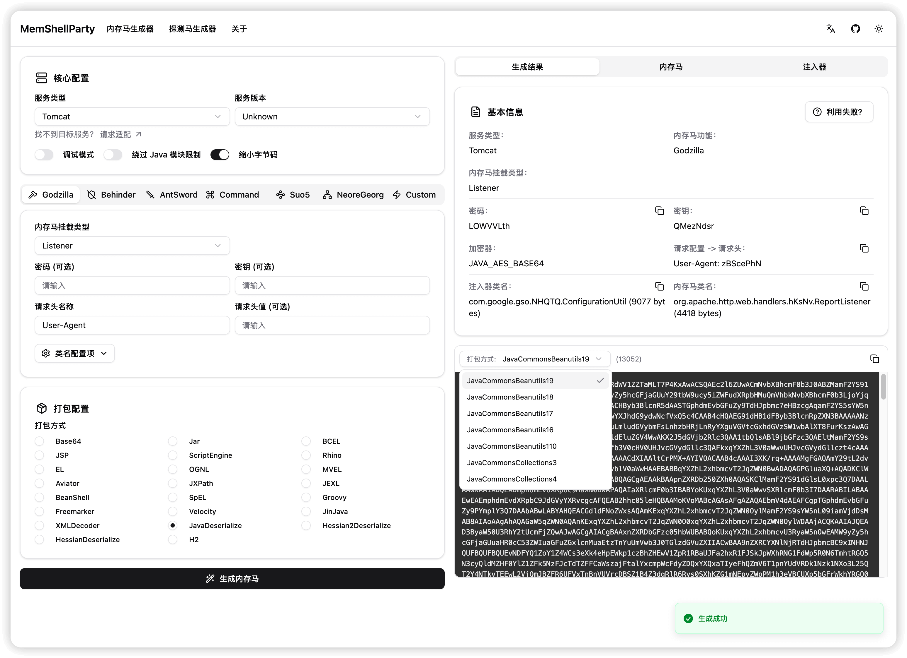
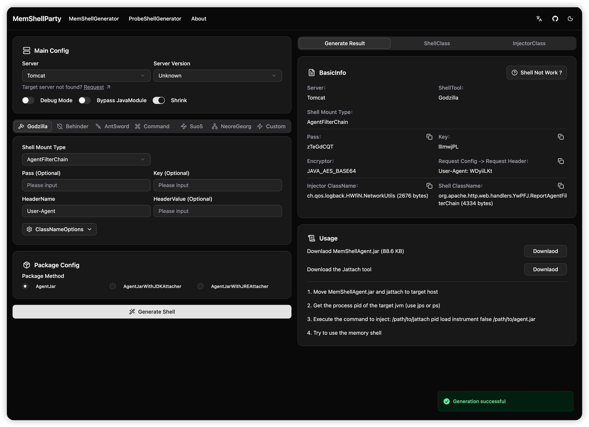
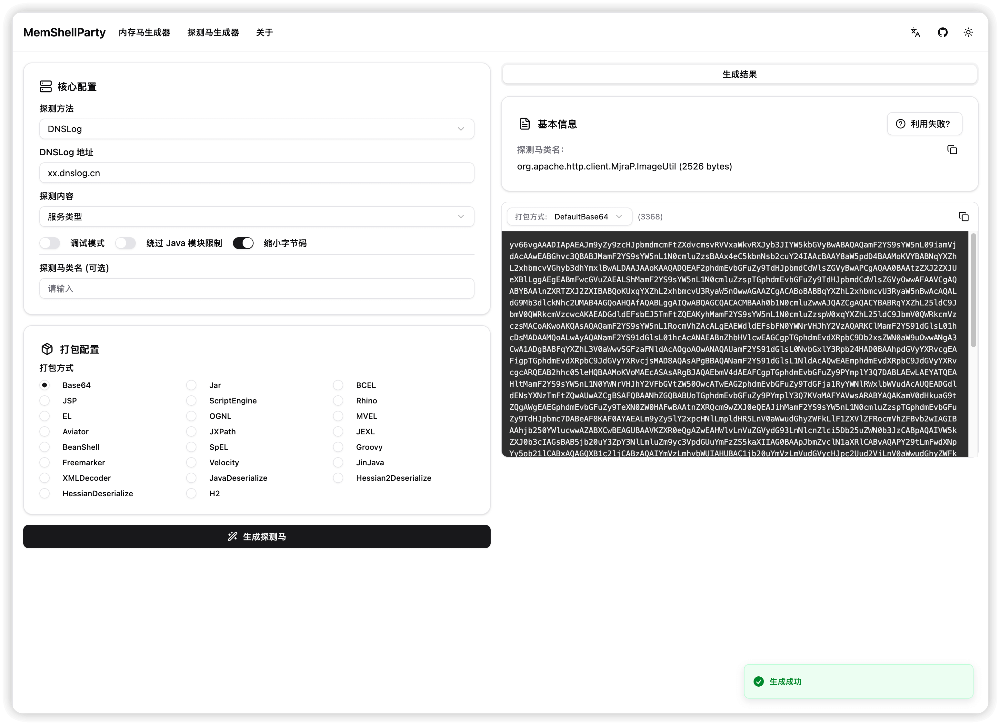
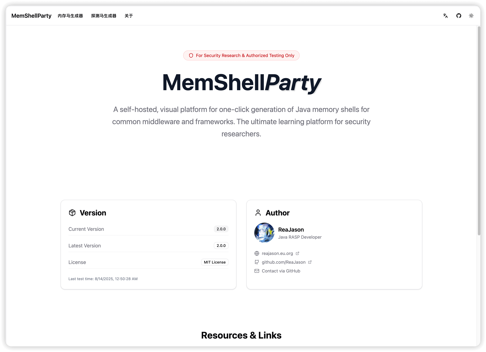

<h1 align="center">MemShellParty</h1>

<p align="center">中文 | <a href="./docs/README.en.md">English</a><br></p>


<div align="center">

[](https://github.com/ReaJason/MemShellParty/releases)
[](https://central.sonatype.com/artifact/io.github.reajason/generator)
[](https://hub.docker.com/r/reajason/memshell-party)
</div>
<div align="center">

[](https://t.me/memshell)
[](https://party.mem.mk)
</div>

> [!WARNING]
> 本工具仅供安全研究人员、网络管理员及相关技术人员进行授权的安全测试、漏洞评估和安全审计工作使用。使用本工具进行任何未经授权的网络攻击或渗透测试等行为均属违法，使用者需自行承担相应的法律责任。

> [!TIP]
> 由于本人仅是安全产品研发，无实战经验，如使用或实现有相关疑问或者适配请求可提 issue 或加入 TG
> 交流群，欢迎一起学习交流。

MemShellParty 是一款专注于主流 Web 中间件的内存马快速生成工具，致力于简化安全研究人员和红队成员的工作流程，提升攻防效率。

<p align="center">
  
  
  
  
</p>

## 主要特性

- **无侵入性**：生成的内存马不会影响目标中间件正常流量，即使同时注入十几个不同的内存马。
- **强兼容性**：覆盖攻防场景下常见中间件和框架，以及 JDK 适配 JDK6 ~ JDK21。
- **高可用性**：对所有支持的中间件框架建立了全面的自动化测试矩阵，确保每一次生成的载荷都具备最高的可用性和稳定性，杜绝实战中的不确定性。
- **极致轻量化**：通过深度优化的字节码生成策略，MemShellParty 将内存马体积相较于 JMG 等传统工具进行了大幅缩小，常规内存马缩小了
  **30%**，Agent 内存马采用 ASM 技术缩小了 **80%**。
- **傻瓜一键化**：内置针对主流表达式注入、反序列化、SSTI 等常见漏洞的载荷生成。系统会自动根据绕过 Java
  模块限制配置，动态生成最优攻击载荷。可实现常规漏洞载荷一键生成。
- **高灵活性**：原生支持哥斯拉、冰蝎、蚁剑、Suo5、NeoreGeorg 等常用内存马功能，通过高度灵活的自定义内存马上传功能，可以将任何定制化载荷融入
  MemShellParty 的生成体系，打造最贴合自身战术需求的攻击平台。

## 快速使用

### 使用前必看

[适配情况](https://party.mem.mk/ui/docs/compatibility)，用于了解 MemShellParty
中针对各个服务适配的情况，针对不同的应用选择合适的服务类型。

探测马中探测服务类型已经做了一一对应，探测出来的服务类型，即是可生成内存马的服务类型（非中间件类型，例如 Apusic10 探测出来的结果为
GlassFish，因为它使用的是 GlassFish 进行的二开）。

### 在线站点

> 仅限尝鲜的小伙伴，对于其他暴露在公网的服务请谨慎使用，小心生成的内存马带后门

可访问（master 分支） [https://party.mem.mk](https://party.mem.mk)。每次 Release 都会自动部署最新的镜像。

对于正在开发的功能可访问（dev 分支）  [https://dev-party.mem.mk](https://dev-party.mem.mk) 抢先体验。

### 本地部署（推荐）

> 适合内网或本地快速部署，直接使用 Docker 启动服务方便快捷

使用 docker 部署之后访问 http://127.0.0.1:8080

```bash
# 使用 Docker Hub 源，拉取最新的镜像
docker run --pull=always --rm -it -d -p 8080:8080 --name memshell-party reajason/memshell-party:latest

# 使用 Github Container Registry 源，拉取最新的镜像
docker run --pull=always --rm -it -d -p 8080:8080 --name memshell-party ghcr.io/reajason/memshell-party:latest

# 网络质量不太好？使用南大 Github Container Registry 镜像源
docker run --pull=always --rm -it -d -p 8080:8080 --name memshell-party ghcr.nju.edu.cn/reajason/memshell-party:latest
```

### 桌面版（Swing GUI）

> 适合不想部署 Web 服务的场景，单个 Jar 双击即用

从 [Releases](https://github.com/ReaJason/MemShellParty/releases) 下载 `memshell-party-gui-x.y.z.jar`，双击运行，或命令行启动：

```bash
java -jar memshell-party-gui-x.y.z.jar
```

运行时要求：Windows / Linux 使用 JDK 8+；macOS 建议 JDK 26+（JDK 8 无 HiDPI 缩放界面会模糊，macOS 26 上 JDK 17/21 存在字体渲染问题）。

想抢先体验开发中的功能，可在 [Dev Deploy](https://github.com/ReaJason/MemShellParty/actions/workflows/dev-deploy.yaml) 工作流的运行记录中下载 `desktop-gui` 构建产物（保留 7 天）。

桌面端拆成两个产物：上面这个 `memshell-party-gui-x.y.z.jar` 是**完整发行版**（内置全部 server 与 shelltool，外壳为「内存马 / 探测马 / 反编译」三页签 + 状态栏）；想把自己的 shelltool 接进这套桌面界面（不用自己写 Swing），依赖 [`memshell-party-gui-sdk`](memshell-party-gui/memshell-party-gui-sdk/README.md) 拿生成器与反编译界面（内存马 / 探测马 / CFR 反编译 frame）并实现 `GuiExtension`，页签、状态栏、品牌由你自己的外壳决定，可运行示例见 [`memshell-party-examples/memshell-party-example-custom-gui`](memshell-party-examples/memshell-party-example-custom-gui)（自定义 server / shelltool / packer / GUI 扩展四类 SPI 一次看全）。

### Woodpecker 插件

> 已经开着 Woodpecker 的时候，不用另开桌面端 / Web 端，直接在里面生成

从 [Releases](https://github.com/ReaJason/MemShellParty/releases) 下载 `memshell-party-woodpecker-x.y.z.jar`，放进 Woodpecker 根目录的 `plugin/` 里重启框架即可（JDK 8 ~ 26 都能跑）：

```bash
cp memshell-party-woodpecker-x.y.z.jar /path/to/woodpecker/plugin/
```

插件在 **Helper** 主页签下注册三个子页签，生成链路与桌面端、Web 端同源（复用 `memshell-party-gui-sdk` 的 controller/service）：

- **内存马生成**：服务端 / 工具 / 挂载类型 / 打包方式等参数 → 打包好的 payload，密码、密钥、请求头、随机类名等实际取值一并打印
- **探测马生成**：DNSLog / ResponseBody / ResponseHeader / Sleep 四种探测方式
- **使用帮助**：列出服务端、工具、挂载类型、打包方式、探测方式、工具参数等全部可选值，填 `keyword` 还能只看匹配项

参数在 **Args** 文本框里按 `参数名=值` 一行一个填，常用参数（服务端/工具/类型/打包方式与几个开关）已按默认值预填，只写要改的（例如 `shellType=Filter`、`pass=abc123`），留空即自动/随机，点 `Generate` 执行；换了服务端或工具后失效的挂载类型会自动回落到可用类型并提示。参数区右上角「?」可查看当前页签的全部参数、类型与说明。

> **JDK 9+ 启动参数**：Woodpecker 自身在 macOS 上需要 `--add-exports java.desktop/com.apple.eawt=ALL-UNNAMED`；反序列化类打包方式（JavaDeserialize 系列）还会用到 xalan 内部 API，需要再加上几个 `--add-exports` / `--add-opens`。「使用帮助」页签里给了两段可直接复制的完整启动命令。

### Shiro-550 利用工具

> 不用另开生成器：探测、Key 爆破、利用链探测与内存马注入在同一条流水线里完成

从 [Releases](https://github.com/ReaJason/MemShellParty/releases) 下载 `memshell-party-shiro-exploit-x.y.z.jar`，双击运行（JDK 8+），或命令行启动：

```bash
java -jar memshell-party-shiro-exploit-x.y.z.jar
```

内存马与 gadget 链全部来自 MemShellParty 注册表，功能与实现见 [`memshell-party-gui/memshell-party-gui-shiro-exploit`](memshell-party-gui/memshell-party-gui-shiro-exploit/README.md)。仅供授权安全测试使用。

### MCP 服务（供其他 Agent 调用）

boot 服务内置了符合最新 MCP 协议规范（Streamable HTTP 传输）的 MCP Server，其他 Agent 可直接通过 Web 端点生成内存马与回显马，端点地址为 `http://127.0.0.1:8080/mcp`。

提供三个工具：

- `memshell_capabilities`：列出所有支持的服务类型、内存马功能、注入类型、打包方式与探测方式（建议先调用以获取合法取值）
- `generate_memshell`：生成内存马（哥斯拉、冰蝎、蚁剑、Suo5、命令执行等），入参与 `POST /api/memshell/generate` 一致
- `generate_probe_shell`：生成回显探测马（DNSLog / ResponseBody / ResponseHeader / Sleep），入参与 `POST /api/probe/generate` 一致

MCP 客户端配置示例：

```json
{
  "mcpServers": {
    "memshell-party": {
      "type": "streamableHttp",
      "url": "http://127.0.0.1:8080/mcp"
    }
  }
}
```

## 贡献者

<a href="https://github.com/ReaJason/MemShellParty/graphs/contributors">
  
</a>

## Special Thanks

- [vulhub/java-chains](https://github.com/vulhub/java-chains)
- [pen4uin/java-memshell-generator](https://github.com/pen4uin/java-memshell-generator)
- [pen4uin/java-echo-generator](https://github.com/pen4uin/java-echo-generator)

### Let's start the party 🎉
