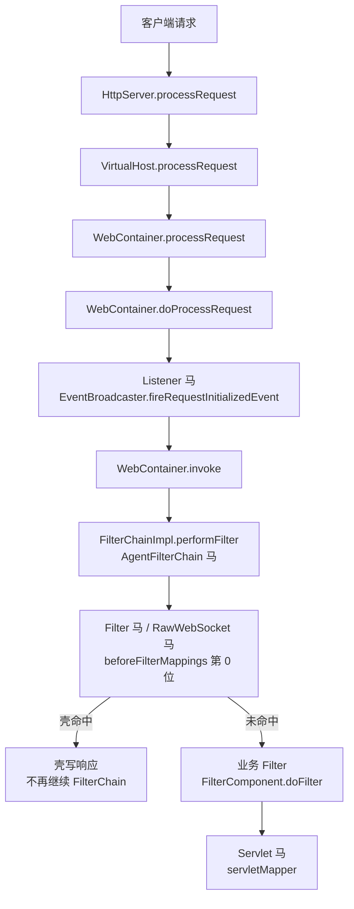

Apusic 9 是金蝶自研的 Servlet 容器，包名为 `com.apusic.web`，请求由 `HttpServer` 经 `VirtualHost` 交给 `WebContainer`，再执行 Listener、Filter 和 Servlet。Apusic 9.0 自带 Tyrus，9.0.1 没有 Tyrus。Apusic 10 改用 GlassFish 二开，服务类型应选 [GlassFish](/docs/middleware/glassfish)。

## 请求链路

Listener 由 `EventBroadcaster.fireRequestInitializedEvent` 在 `WebContainer.doProcessRequest` 中触发，早于 `WebContainer.invoke` 和 Filter 链；Apusic 的 Listener 位置和 Catalina 系容器不同，但同样在 Filter 之前。

## 挂载点与触发时机

| 类型 | 挂载点 | 触发时机 | URL 约束 | Filter 位置 |
| --- | --- | --- | --- | --- |
| Listener | `webapp.addListener` 与 `context.loadListeners` | `WebContainer.doProcessRequest` | 无 URL，WebApp 内全部请求 | 之前 |
| Filter | `beforeFilterMappings[0]` | `FilterChainImpl.performFilter` | `/*` 或 path 模式 | 链首位 |
| Servlet | `webapp.addServlet` 与 `servletMapper.addMapping` | Filter 链之后 | 精确、前缀或扩展名映射 | 之后 |
| RawWebSocket | Filter，同 Filter 马 | 握手请求 | 同 Filter | 链首位 |
| AgentFilterChain | `FilterChainImpl.performFilter` | Filter 链入口 | 无 URL | 之前 |

Apusic 9.0 支持 WebSocket，9.0.1 不支持；两个版本都支持 Servlet、Filter、Listener、AgentFilterChain 与 RawWebSocket。各版本的完整支持矩阵见 [目标服务](/docs/server-intro#apusic)。

## Listener 与 Filter 的 URL 规则

**Listener 没有 URL。** 注入器把壳注册到 `webapp` 并调用 `context.loadListeners`，`WebContainer.doProcessRequest` 在建立 Filter 链之前调用 `fireRequestInitializedEvent`。请求只要被 `VirtualHost` 分到该 WebApp 就会触发，包括最终 404 的路径，而且早于所有业务 Filter。已在 Apusic 9.0 与 9.0.1 上验证。

**Filter 的 URL 不需要和已声明 Servlet 对齐。** 注入器把壳的 `FilterComponent` 插到 `beforeFilterMappings` 第 0 位并重建 `filterMapper`，`FilterChainImpl.performFilter` 按 pattern 直接匹配请求路径，`/*`、`/prefix/*`、`*.ext` 和精确路径都有效。已在 Apusic 9/9.0.1 上验证 `/*` 的 Filter 马对不存在的 `/app/no-such-path` 可以直接返回 200。

请求不需要先完成 Servlet 映射，Filter 链在 `WebContainer.invoke` 阶段就会建立；即使最终 404，Filter 也已经执行。壳只处理 `REQUEST` 派发，FORWARD、INCLUDE、ERROR、ASYNC 不会再次触发。

## 其他限制

**WebSocket** 只在 Apusic 9.0 可用，通过自带的 Tyrus `ServerContainer` 注册 Endpoint。Apusic 9.0.1 没有 `tyrus-client`，无法提供 JSR-356 容器，WebSocket 挂载类型不可用，需要 WebSocket 时选 RawWebSocket。Endpoint 路径只支持精确路径或 URI 模板，不能写 `/*`。

**RawWebSocket** 是一个 Filter。Apusic 9/9.0.1 没有可用的 HTTP Upgrade 机制，helper 直接接管连接器 `SocketAdaptor` 的 `Channel`，自己完成握手和帧循环。收尾时不要调用 `abort`，而是标记连接已结束并补上 `Connection: close`，让容器自己完成一次 abort；手工 abort 会让容器再处理一次已经关闭的连接。

**AgentFilterChain** 由 Java Agent 改写 `com.apusic.web.container.FilterChainImpl.performFilter` 的字节码，在 Filter 链入口执行，不需要 URL。Agent 马的存活依赖 agent 进程，可选持久化，具体见 [Java Agent 内存马](/docs/agent-shell)。
