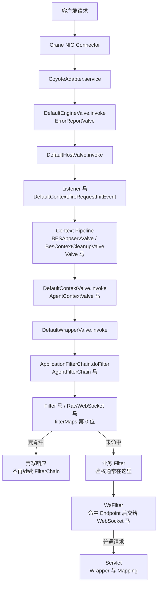

BES 基于 Tomcat 二开，9.5.1 没有改包名、服务类型应选 [Tomcat](/docs/middleware/tomcat)；9.5.2 起包名改为 `com.bes.enterprise.`，服务类型选 BES。BES 9.5.2~10 使用 javax 类型，BES 11 使用 Jakarta 类型。请求仍然走 Engine、Host、Context、Wrapper 四层 Pipeline，Listener 在 Host Valve 内触发。

## 请求链路

`DefaultContext.fireRequestInitEvent` 在 `DefaultHostValve.invoke` 内调用，早于 `DefaultContextValve` 和 Context Pipeline。BES 11 的 `DefaultHostValve` 前还会经过 `BESSecurityRequestValve`，Listener 的触发时机不变。

## 挂载点与触发时机

| 类型 | 挂载点 | 触发时机 | URL 约束 | Filter 位置 |
| --- | --- | --- | --- | --- |
| Listener | `applicationEventListeners` | `DefaultHostValve.invoke` | 无 URL，Context 内全部请求 | 之前 |
| Valve | `context.getPipeline().addValve` | Basic Valve 前 | 无 URL，404 路径也触发 | 之前 |
| Filter | `filterMaps[0]` | `ApplicationFilterChain` 链首 | `/*` 或 path 模式 | 链首位 |
| WebSocket | `ServerContainer` | WsFilter 命中后 | Endpoint 路径或模板 | 之后 |
| RawWebSocket | Filter，同 Filter 马 | 握手请求 | 同 Filter | 链首位 |
| AgentFilterChain | `ApplicationFilterChain.doFilter` | Filter 链入口 | 无 URL | 之前 |
| AgentContextValve | `DefaultContextValve.invoke` | Context Basic Valve 入口 | 无 URL | 之前 |

BES 不提供 Servlet 挂载类型，需要 Servlet 形态时用 Filter 马处理任意路径。各版本的完整支持矩阵见 [目标服务](/docs/server-intro#bes)。

## Listener 与 Filter 的 URL 规则

**Listener 没有 URL。** 注入器把壳加到 `applicationEventListeners`，`DefaultHostValve` 在进入 Context Pipeline 之前调用 `DefaultContext.fireRequestInitEvent`。请求只要被 Mapper 分到该 Context 就会触发，包括最终 404 的路径，并且早于所有 Valve 和 Filter。BES 9.5.2、9.5.5、11 使用同一个 `DefaultHostValve` 调用栈；BES 9.5.1 走 Tomcat 的 `StandardHostValve`，触发时机相同。

**Filter 的 URL 不需要和已声明 Servlet 对齐。** 注入器使用 BES 的 `FilterDef` / `FilterMap`，把壳通过 `addFilterMapBefore` 放到 `filterMaps` 第 0 位，写进 `filterConfigs`。BES 在 `ApplicationFilterFactory` 中把 FilterMap 的 pattern 直接和 Context 相对路径比较，`/*`、`/prefix/*`、`*.ext` 和精确路径都有效。已在 BES 9.5.5 与 11 上验证 `/*` 的 Filter 马对不存在的 `/app/no-such-path` 可以直接返回 200。

请求仍然要能落到一个 Wrapper。`DefaultContextValve` 在 Wrapper 为空时直接 404，`ApplicationFilterChain` 只在 `DefaultWrapperValve` 中创建；BES 默认有映射到 `/` 的 default servlet，所以 `/*` 对绝大多数路径成立。FilterMap 的 dispatcher 默认只有 `REQUEST`，FORWARD、INCLUDE、ERROR、ASYNC 派发不会再次触发壳。

## 其他限制

**Valve** 追加到 Context Pipeline，排在 `DefaultContextValve` 之前。Listener 在 HostValve 阶段已经执行，所以 Listener 马比 Valve 马更早，Valve 马绕不过 Listener 马。Valve 没有 URL，404 路径也会触发。

**WebSocket** 通过 BES 自带的 JSR-356 `ServerContainer` 注册 Endpoint。BES 9.5.2~10 使用 `javax.websocket`，BES 11 使用 `jakarta.websocket`。Endpoint 路径只支持精确路径或 URI 模板，不能写 `/*`。

**RawWebSocket** 是一个 Filter，helper 复用 Tomcat 的连接器实现并按 BES 包名分支。BES 10 关闭连接时会按 `connections` 回收 processor，close 前必须先把当前连接从映射中摘掉，否则回收逻辑会重复处理已经关闭的连接。BES 10 在 JDK 17 上扫描线程时，单个线程取字段可能抛 `InaccessibleObjectException`，扫描循环要逐线程 try/catch，不能因为一个线程失败就终止整个扫描。

**Agent 类型** 由 Java Agent 改写 `com.bes.enterprise.webtier.core.ApplicationFilterChain.doFilter` 或 `DefaultContextValve.invoke` 的字节码，分别在 Filter 链入口和 Context Basic Valve 入口执行，不需要 URL。Agent 马的存活依赖 agent 进程，可选持久化，具体见 [Java Agent 内存马](/docs/agent-shell)。
