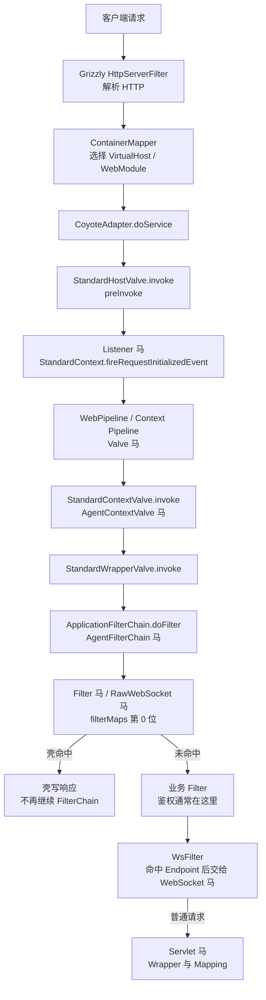

GlassFish 的 Servlet 容器直接使用 Catalina 的实现，HTTP 连接器是 Grizzly：Grizzly 解析完请求后交给 `ContainerMapper`，再进入 Catalina 的 Engine、Host、Context、Wrapper 四层 Pipeline。类加载采用 OSGi 模式，跨模块反射要经过对应的 Bundle ClassLoader。GlassFish 3~5、Payara 5 使用 javax 类型，GlassFish 6+、Payara 6+ 使用 Jakarta 类型；Apusic 10、Primeton 6.5 基于 GlassFish 二开，服务类型都选 GlassFish。

## 请求链路

GlassFish 的 Listener 由 `StandardHostValve.preInvoke` 调用，位置在 Context Pipeline 之前；这一点和 Tomcat 相同。GlassFish 7 与 Payara 7 的 `StandardHostValve` 仍然保留 `preInvoke`，Listener 的触发点没有变化。

## 挂载点与触发时机

| 类型 | 挂载点 | 触发时机 | URL 约束 | Filter 位置 |
| --- | --- | --- | --- | --- |
| Listener | `applicationEventListeners` | `StandardHostValve.preInvoke` | 无 URL，Context 内全部请求 | 之前 |
| Valve | `context.getPipeline().addValve` | Basic Valve 前 | 无 URL，404 路径也触发 | 之前 |
| Filter | `filterMaps[0]` | `ApplicationFilterChain` 链首 | `/*` 或 path 模式 | 链首位 |
| Servlet | Wrapper 与 mapping | Filter 后 | 精确或前缀映射 | 之后 |
| AgentContextValve | `StandardContextValve` | `invoke` | 无 URL | 之前 |
| AgentFilterChain | `ApplicationFilterChain` | `doFilter` | 无 URL | 之前 |
| WebSocket | `ServerContainer` | WsFilter 命中后 | Endpoint 路径或模板 | 之后 |
| RawWebSocket | Filter，同 Filter 马 | 握手请求 | 同 Filter | 链首位 |

GlassFish 3.x 只支持 javax 类型；GlassFish 4/5、Payara 5 同样使用 javax；GlassFish 6+、Payara 6+ 的 Listener、Filter、Valve、WebSocket 使用 `Jakarta` 前缀的类型。各版本的完整支持矩阵见 [目标服务](/docs/server-intro#glassfish)。

## Listener 与 Filter 的 URL 规则

**Listener 没有 URL。** 注入器把壳加进 `StandardContext.applicationEventListeners`，`StandardHostValve.preInvoke` 在进入 Context Pipeline 之前调用 `fireRequestInitializedEvent`。请求只要被 Mapper 分到该 Context 就会触发，早于所有 Valve 和 Filter，包括最终 404 的路径。已在 GlassFish 3.1.2、4.1、5.1、7 与 Payara 7 上抓到同一个调用栈。

**Filter 的 URL 不需要和已声明 Servlet 对齐。** GlassFish 复用 Catalina 的 `ApplicationFilterFactory`，`FilterMap` 的 pattern 直接和 Context 相对路径比较，`/*`、`/prefix/*`、`*.ext` 和精确路径都有效。注入器把壳放在 `filterMaps` 第 0 位，因此先于业务 Filter。已在 GlassFish 4.1、5.1、7 与 Payara 7 上验证 `/*` 的 Filter 马对不存在的 `/app/no-such-path` 可以直接返回 200；GlassFish 3.1.2 使用同一套 Catalina 代码。

请求仍然要能落到一个 Wrapper。GlassFish 默认有映射到 `/` 的默认 Servlet，因此 `/*` 对绝大多数路径成立；如果应用删掉了默认映射，未匹配路径会在 `StandardContextValve` 处 404，根本到不了 Filter 链。FilterMap 的 dispatcher 默认只有 `REQUEST`，FORWARD、INCLUDE、ERROR、ASYNC 派发不会再次触发壳。

## 其他限制

**Valve** 追加到 Context Pipeline，排在 `StandardContextValve` 之前。Listener 在 HostValve 阶段已经执行，所以 Listener 马比 Valve 马更早，Valve 马绕不过 Listener 马。Valve 没有 URL，404 路径也会触发。

**WebSocket** 通过 Tyrus 的 JSR-356 `ServerContainer` 注册 Endpoint。GlassFish 4+、Payara 5+ 自带 Tyrus；注入器优先调用 Tyrus 的 `register`，直接写入 `WebSocketEngine`，因为部署结束后 `addEndpoint` 会抛 `IllegalStateException`；Tyrus 每次升级都按当前端点集合匹配路径，不需要刷新 Filter 映射。GlassFish 6+、Payara 6+ 使用 `jakarta.websocket`。GlassFish 3.x 没有 JSR-356，只能选 RawWebSocket。Endpoint 路径只支持精确路径或 URI 模板，不能写 `/*`。

**RawWebSocket** 是一个 Filter，壳完成 101 后由 Grizzly 专属 helper 接管底层 `SocketChannel`，自己跑帧循环。GlassFish 3~8、Payara 5~7 的 Grizzly 1.x/2.x 共用这份实现，不依赖容器的 WebSocket API，也不依赖 `Upgrade` 和 `Connection` 逐跳头，能穿过会剥掉这些头的 Nginx、CDN。

**Agent 类型** 复用 Tomcat 的注入器，改写 `ApplicationFilterChain.doFilter` 或 `StandardContextValve.invoke` 的字节码，不需要 URL。GlassFish 使用 OSGi 类加载，Agent 改写的是 `org.apache.catalina` 下的类，类名与 Tomcat 相同。Agent 马的存活依赖 agent 进程，可选持久化，具体见 [Java Agent 内存马](/docs/agent-shell)。
