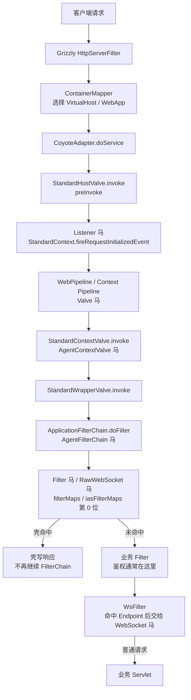

InforSuite 基于 GlassFish 二开，Servlet 容器沿用 Catalina 的实现，HTTP 连接器是 `com.cvicse.inforsuite.grizzly`，应用入口是 `com.cvicse.loong.enterprise.v9` 的 `ContainerMapper`。InforSuite 9/10 都使用 javax 类型。InforSuite 10 把部分 Filter 字段改成了 `iasFilterMaps` / `iasFilterConfigs`，注入器按版本分别处理。

## 请求链路

Listener 由 `StandardHostValve.preInvoke` 调用 `StandardContext.fireRequestInitializedEvent`，位置在 Context Pipeline 之前，和 GlassFish 相同。InforSuite 10 的 `WebPipeline` 位于 `com.cvicse.loong.enterprise.web`，Pipeline 结构没有变化。

## 挂载点与触发时机

| 类型 | 挂载点 | 触发时机 | URL 约束 | Filter 位置 |
| --- | --- | --- | --- | --- |
| Listener | `applicationEventListeners` | `StandardHostValve.preInvoke` | 无 URL，Context 内全部请求 | 之前 |
| Valve | `context.getPipeline().addValve` | Basic Valve 前 | 无 URL，404 路径也触发 | 之前 |
| Filter | `filterMaps[0]` / `iasFilterMaps.array[0]` | `ApplicationFilterChain` 链首 | `/*` 或 path 模式 | 链首位 |
| WebSocket | `ServerContainer` | WsFilter 命中后 | Endpoint 路径或模板 | 之后 |
| RawWebSocket | Filter，同 Filter 马 | 握手请求 | 同 Filter | 链首位 |
| AgentFilterChain | `ApplicationFilterChain.doFilter` | Filter 链入口 | 无 URL | 之前 |
| AgentContextValve | `StandardContextValve.invoke` | Context Basic Valve 入口 | 无 URL | 之前 |

InforSuite 不提供 Servlet 挂载类型，需要 Servlet 形态时用 Filter 马处理任意路径。各版本的完整支持矩阵见 [目标服务](/docs/server-intro#inforsuite)。

## Listener 与 Filter 的 URL 规则

**Listener 没有 URL。** 注入器把壳加进 `StandardContext.applicationEventListeners`，`StandardHostValve.preInvoke` 在进入 Context Pipeline 之前触发。请求只要被 Mapper 分到该 Context 就会触发，包括最终 404 的路径，并且早于所有 Valve 和 Filter。已在 InforSuite 9.1 与 10 上抓到同一个调用栈。

**Filter 的 URL 不需要和已声明 Servlet 对齐。** 注入器使用 Catalina 的 `FilterDef` / `FilterMap`，InforSuite 9 把壳插到 `filterMaps` 列表第 0 位，InforSuite 10 改成重建 `iasFilterMaps.array` 并前插；Filter 配置分别写入 `filterConfigs` 或 `iasFilterConfigs`。匹配时 pattern 直接和 Context 相对路径比较，`/*`、`/prefix/*`、`*.ext` 和精确路径都有效。已在 InforSuite 9.1 与 10 上验证 `/*` 的 Filter 马对不存在的 `/app/no-such-path` 可以直接返回 200。

请求仍然要能落到一个 Wrapper。`StandardContextValve` 在 Wrapper 为空时直接 404，`ApplicationFilterChain` 只在 `StandardWrapperValve` 中创建；InforSuite 默认有映射到 `/` 的 default servlet，所以 `/*` 对绝大多数路径成立。FilterMap 的 dispatcher 默认只有 `REQUEST`，FORWARD、INCLUDE、ERROR、ASYNC 派发不会再次触发壳。

## 其他限制

**Valve** 追加到 Context Pipeline，排在 `StandardContextValve` 之前。Listener 在 HostValve 阶段已经执行，所以 Listener 马比 Valve 马更早，Valve 马绕不过 Listener 马。Valve 没有 URL，404 路径也会触发。

**WebSocket** 通过 InforSuite 自带的 Tyrus `ServerContainer` 注册 Endpoint，9/10 都自带 `tyrus-container-servlet.jar`。Endpoint 路径只支持精确路径或 URI 模板，不能写 `/*`。

**RawWebSocket** 是一个 Filter，helper 使用 `com.cvicse.inforsuite.grizzly` 的 Grizzly 版本接管底层 `SocketChannel`，自己完成握手和帧循环。它不依赖容器的 WebSocket API，也不依赖 `Upgrade` 和 `Connection` 逐跳头。

**Agent 类型** 复用 Tomcat 的注入器，改写 `ApplicationFilterChain.doFilter` 或 `StandardContextValve.invoke` 的字节码，分别在 Filter 链入口和 Context Basic Valve 入口执行，不需要 URL。Agent 马的存活依赖 agent 进程，可选持久化，具体见 [Java Agent 内存马](/docs/agent-shell)。
