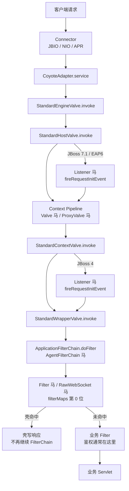

JBoss AS 4~7.1 与 JBoss EAP 6 使用 JBossWeb，它是 Catalina 的分支；JBoss EAP 7/8 与 WildFly 换成 Undertow，服务类型应选择 [Undertow](/docs/middleware/undertow)。JBossWeb 的请求处理沿用 Catalina 的 Engine、Host、Context、Wrapper 四层 Pipeline，但 Valve 与 Filter 的挂载点、以及 Listener 的触发位置，会随 JBossWeb 版本变化。

## 请求链路

JBoss 4 的 Listener 在 `StandardContextValve.invoke` 内触发，此时 Context Pipeline 上的 Valve 已经执行完；JBoss AS 7.1 与 EAP 6 的 Listener 在 `StandardHostValve.invoke` 内触发，早于 Context Pipeline。这个差异决定了 Valve 马与 Listener 马谁先看到请求。

## 挂载点与触发时机

| 类型 | 挂载点 | 触发时机 | URL 约束 | Filter 位置 |
| --- | --- | --- | --- | --- |
| Listener | `applicationEventListeners` | JBoss 4：`StandardContextValve.invoke`；7.1/EAP6：`StandardHostValve.invoke` | 无 URL，Context 内全部请求 | 之前 |
| Valve | `context.getPipeline().addValve` | Basic Valve 前 | 无 URL，404 路径也触发 | 之前 |
| ProxyValve | `pipeline.first` | 所有 Valve 前 | 无 URL | 之前 |
| Filter | `filterMaps[0]` | Filter 链首 | `/*` 或 Servlet 路径模式 | 链首位 |
| AgentContextValve | `StandardContextValve` | `invoke` | 无 URL | 之前 |
| AgentFilterChain | `ApplicationFilterChain` | `doFilter` | 无 URL | 之前 |
| RawWebSocket | Filter，同 Filter 马 | 握手请求 | 同 Filter | 链首位 |

JBossWeb 没有 Servlet 与 JSR-356 WebSocket 挂载类型。需要 Servlet 形态时使用 Filter 马处理任意路径；需要 WebSocket 时使用 RawWebSocket。JBoss 4~7.1/EAP6 的默认连接器是 JBIO，RawWebSocket 与 Tomcat 共用同一份 helper。各版本的完整支持矩阵见 [目标服务](/docs/server-intro#jboss)。

## Listener 与 Valve 的先后

这是 JBossWeb 与 Tomcat 6+ 最容易混淆的一点。

**JBoss 4** 基于 Catalina 5.5，`StandardContextValve.invoke` 自己调用 `fireRequestInitEvent`。注入器把 Valve 追加在 Context Pipeline 的 Basic Valve 之前，所以顺序是：Host Pipeline → Context Valve 马 → `StandardContextValve` → Listener 马 → Wrapper。Listener 马绕不过已经执行的 Valve 马。

**JBoss AS 7.1 / EAP 6** 基于更新的 Catalina，`StandardHostValve.invoke` 在进入 Context Pipeline 前调用 `fireRequestInitEvent`。顺序是：Host Pipeline → Listener 马 → Context Valve 马 → `StandardContextValve` → Wrapper。Listener 马比 Valve 马更早。

Listener 没有 URL，请求只要被 Mapper 分到该 Context 就会触发，包括最终 404 的路径。Valve 和 ProxyValve 同样没有 URL；ProxyValve 替换 `pipeline.first`，排在所有 Valve 之前。

## Filter 的 URL 规则

**Filter 的 URL 不需要和已声明 Servlet 对齐。** JBossWeb 在 `ApplicationFilterFactory.createFilterChain` 中把 FilterMap 的 pattern 直接和 Context 相对路径比较，`/*`、`/prefix/*`、`*.ext` 和精确路径都有效。注入器把壳放在 `filterMaps` 第 0 位，因此先于业务 Filter。已验证在 JBoss 4.0.5、JBoss AS 7.1 和 EAP 6 上，`/*` 的 Filter 马对不存在的 `/app/no-such-path` 也能直接返回 200。

请求仍然要能落到一个 Wrapper。`StandardContextValve` 在 Wrapper 为空时直接 404，`ApplicationFilterChain` 只在 `StandardWrapperValve` 中创建。JBossWeb 默认有映射到 `/` 的 default servlet，所以 `/*` 对绝大多数路径成立；如果应用删掉了默认映射，指向不存在路径的请求会在到达 Filter 之前 404。

FilterMap 的 dispatcher 默认只有 `REQUEST`，FORWARD、INCLUDE、ERROR、ASYNC 派发不会再次触发壳。

## 其他限制

**RawWebSocket** 是一个 Filter，壳识别 `GET` 与 `Sec-WebSocket-Key`，完成 101 后由 helper 反射拿到 JBossWeb 连接器的底层 socket，自己跑帧循环。JBoss 服务类型不提供 JSR-356 WebSocket 挂载，需要 WebSocket 时只能选 RawWebSocket；它不依赖 `Upgrade` 和 `Connection` 逐跳头，能穿过会剥掉这些头的 Nginx、CDN。

**Agent 类型** 不修改容器注册表，而是由 Java Agent 改写 `ApplicationFilterChain.doFilter` 或 `StandardContextValve.invoke` 的字节码。前者在 Filter 链入口执行，后者在 Context Basic Valve 入口执行，都不需要 URL。Agent 马的存活依赖 agent 进程，可选持久化，具体见 [Java Agent 内存马](/docs/agent-shell)。
