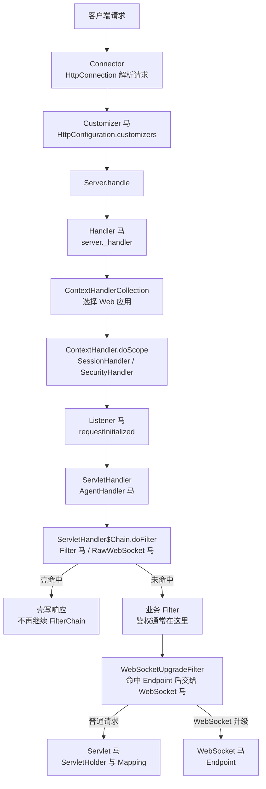
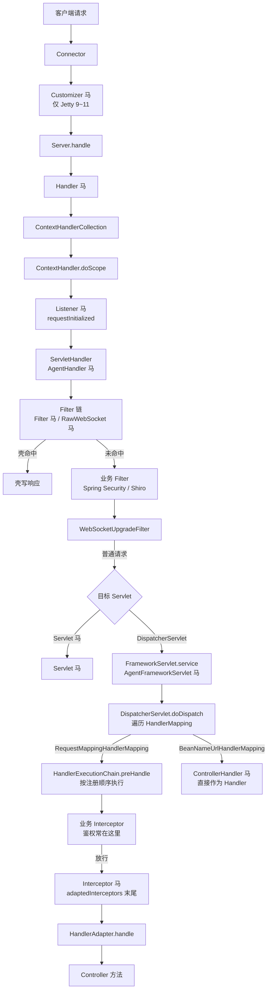

Jetty 的请求从 `Server` 的 Handler 树进入，先由 `ContextHandlerCollection` 选中 Web 应用，再由 `ContextHandler` 协调 `SessionHandler`、`SecurityHandler`、`ServletHandler`。Jetty 5/6 使用 `org.mortbay.jetty` 包名，7 以上使用 `org.eclipse.jetty`，12 再按 `ee8` ~ `ee11` 分包。内存马可以挂在 HTTP 层、Handler 树、Servlet 组件或 WebSocket Endpoint 上。

## 请求链路

Jetty 6 的 Listener 在 `ServletHandler.handle` 入口触发；Jetty 7 以上在 `ContextHandler.doHandle` 的 `requestInitialized` 触发；Jetty 12 的 ee9~ee11 由 `ServletChannel.dispatch` 进入 `ServletContextHandler.requestInitialized`。三者都在 `ServletHandler` 的 Filter 链之前。Jetty 5 是例外：容器本身不在 Handler 阶段派发 `ServletRequestListener`，注入器会补装 `JSR154Filter`，由它在 Filter 链首触发 Listener。

## 挂载点与触发时机

| 类型 | 挂载点 | 触发时机 | URL 约束 | Filter 位置 |
| --- | --- | --- | --- | --- |
| Listener | `ServletContext.addEventListener` | Context 选出后、`ServletHandler` 前；Jetty 5 由 `JSR154Filter` 触发 | 无 URL，Context 内全部请求 | 之前 |
| Filter | `_servletHandler._filterMappings[0]` | `ServletHandler$Chain.doFilter` 首位 | `/*` 或 Servlet 路径模式 | 链首位 |
| Servlet | `ServletHolder` 与 `addServletWithMapping` | Filter 链之后 | 精确、前缀或扩展名映射 | 之后 |
| Handler | `Server._handler` | Server 收到请求后第一步 | 无 URL，整台 Server 全部请求 | 之前 |
| Customizer | `HttpConfiguration.customizers`（Jetty 9~11） | `HttpChannel` 创建 Request/Response 时 | 无 URL，共享该配置的全部请求 | 之前 |
| AgentHandler | `ServletHandler.doHandle` 或 `ServletHandler$Chain.doFilter` | Servlet 分发入口 | 无 URL | 之前 |
| WebSocket | `ServerContainer.addEndpoint` | WebSocket 升级请求命中 Endpoint | Endpoint 路径或 URI 模板，不能 `/*` | 视 WebSocket 模块顺序 |
| RawWebSocket | Filter，同 Filter 马 | `GET` 与 `Sec-WebSocket-Key` | 同 Filter | 链首位 |

Jetty 5 只支持 Servlet、Filter、Listener 三种类型；Handler 从 Jetty 6 开始，Customizer 从 Jetty 9 开始，Jetty 12 的 `HttpConfiguration` 移除了 customizers，不再支持 Customizer。Jetty 12 ee9~ee11 使用 `Jakarta` 前缀的挂载类型，ee8 仍使用不带前缀的类型。各版本的完整支持矩阵见 [目标服务](/docs/server-intro#jetty)。

## Listener 与 Filter 的 URL 规则

**Listener 没有 URL。** 注入器把壳加进 Context 的事件监听器列表，请求只要被 `ContextHandlerCollection` 分到该 Context 就会触发，包括最终 404 的路径。Jetty 5 的监听器依赖 `JSR154Filter` 派发，注入器会把该 Filter 定义并前插到 `/*`；没有这个 Filter 时，web.xml 里声明的 `ServletRequestListener` 也不会触发。

**Filter 的 URL 不需要和已声明 Servlet 对齐。** Jetty 在 `ServletHandler` 里按路径模式组装 Filter 链，pattern 直接和 Context 相对路径比较，`/*`、`/prefix/*`、`*.ext` 和精确路径都有效。注入器把壳的 `FilterMapping` 放在 `_filterMappings` 第 0 位并清空 `_chainCache`，因此先于业务 Filter。已验证在 5.1、6.1、7.6、9.2、10、11、12 ee8/ee9/ee10/ee11 上，`/*` 的 Filter 马对不存在的 `/app/no-such-path` 也能直接返回 200。

Filter 的 dispatcher 只声明了 `REQUEST`（`setDispatches(1)`），FORWARD、INCLUDE、ERROR、ASYNC 派发不会再次触发壳。容器内部 Filter（例如 WebSocket 模块的 `WebSocketUpgradeFilter`、Jetty 的 `SecurityHandler`）由 Jetty 自行插入，顺序随版本和模块配置变化；壳只保证排在业务 Filter 之前，不保证先于这些内部组件。

## 其他限制

**Handler** 直接替换 `Server._handler`，壳把原 Handler 存进自己的 `nextHandler`。它在 Context 选择之前执行，因此没有 URL 约束，也能命中不属于任何 Web 应用的请求；壳必须把未命中的请求交回 `nextHandler`，否则整台 Server 的请求都会被截断。Jetty 6 通过 `getContainer().addBean` 管理生命周期，7 以上通过 `Server.addBean`。

**Customizer** 追加到 `HttpConfiguration.getCustomizers()`，由 `HttpChannel` 在每个请求上调用，位置比 Handler 树更早。它拿到的是 `Connector`、`Request`、`Response`，没有 URL，也不能依赖 Servlet 对象；Jetty 9~11 可用，Jetty 12 已从 `HttpConfiguration` 移除 customizers，只能选 Handler、Listener、Filter 或 AgentHandler。注入器会遍历线程上下文中出现的 `HttpChannel`，把壳加到它们共享的 `HttpConfiguration` 上。

**WebSocket** 注册到 ServletContext 中的 `ServerContainer`，路径是 Endpoint 路径而不是 Servlet 映射。Endpoint 只支持精确路径或 URI 模板，不能写 `/*`。Jetty 9.1+ 自带 JSR-356；Jetty 12 默认不加载 WebSocket 模块，需要启动时启用对应的 `eeN-websocket-javax` / `eeN-websocket-jakarta` 模块，Spring Boot 内嵌 Jetty 需要 classpath 中存在 `websocket-javax-server` / `websocket-jakarta-server`。Jetty 5/6/7/8 没有可用的 JSR-356，使用 RawWebSocket。

**RawWebSocket** 是一个 Filter，壳识别 `GET` 与 `Sec-WebSocket-Key`，完成 101 后由 helper 从 `Request` 逐层找到 `EndPoint` 并自己跑帧循环，不依赖容器的 WebSocket 实现，也不依赖 `Upgrade` 和 `Connection` 逐跳头。Jetty 6~12 共用同一份 helper，javax 与 Jakarta 部署都能用。

**AgentHandler** 由 Java Agent 改写 `ServletHandler.doHandle`（Jetty 6~12 ee8/ee9）或 `ServletHandler$Chain.doFilter`（Jetty 12 ee10/ee11）的字节码，在 Filter 链入口执行，不需要 URL。Agent 马的存活依赖 agent 进程，可选持久化，具体见 [Java Agent 内存马](/docs/agent-shell)。

## SpringWebMVC + Jetty

Spring Boot 1.x/2.x 的 `spring-boot-starter-jetty` 对应 Jetty 9.x，Spring Boot 3.0/3.1 对应 Jetty 11.x，Spring Boot 3.2+ 对应 Jetty 12 ee10。除 Jetty 12 不再支持的 Customizer 外，容器级挂载点都有效，Wrapper 变成 `DispatcherServlet`，进入后再多出三种框架级挂载点。

| 类型 | 挂载点 | 触发时机与约束 |
| --- | --- | --- |
| Interceptor | `adaptedInterceptors` 末尾 | `preHandle`；只处理 RequestMappingHandlerMapping 命中的请求，业务 Interceptor 先执行 |
| ControllerHandler | `handlerMap` | HandlerMapping 查找阶段；注册在 BeanNameUrlHandlerMapping，新增 URL 不能被 RequestMappingHandlerMapping 先命中 |
| AgentFrameworkServlet | `FrameworkServlet.service` | 进入 DispatcherServlet 后、`doDispatch` 前；在 Servlet Filter 之后、MVC Interceptor 之前 |

**鉴权在 Filter 时**，Spring Security 的 `FilterChainProxy`、Shiro 的 `ShiroFilter` 都是 Servlet Filter，执行在 `DispatcherServlet` 之前，三种框架级内存马都绕不过。能绕开的是排在业务 Filter 之前的挂载点：Customizer（Jetty 9~11）、Handler、Listener、AgentHandler、Filter 马和 RawWebSocket。Customizer 在 Handler 树之前，Handler 在 Context 选择之前，Listener 在 `ServletHandler` 之前；Filter 马被放到 `_filterMappings` 首位。Servlet 马、WebSocket 马在业务 Filter 之后，绕不过。Jetty 12 没有 Customizer，可用的前置挂载点是 Handler、Listener、AgentHandler、Filter 马和 RawWebSocket。

**鉴权在 Interceptor 时**，Interceptor 马追加在 `adaptedInterceptors` 末尾，业务 Interceptor 先执行；ControllerHandler 挂在另一个 HandlerMapping 上，通常不经过 `WebMvcConfigurer` 注册的业务 Interceptor，但 Spring Security 这类 Filter 仍然在前；AgentFrameworkServlet 在 `doDispatch` 之前，也不经过 Interceptor。

Spring Boot 3/4 选择 `JakartaInterceptor`、`JakartaControllerHandler`，Spring Boot 1/2 选择不带前缀的 `Interceptor`、`ControllerHandler`；`AgentFrameworkServlet` 同时支持 javax 与 jakarta，没有 Jakarta 变体。
