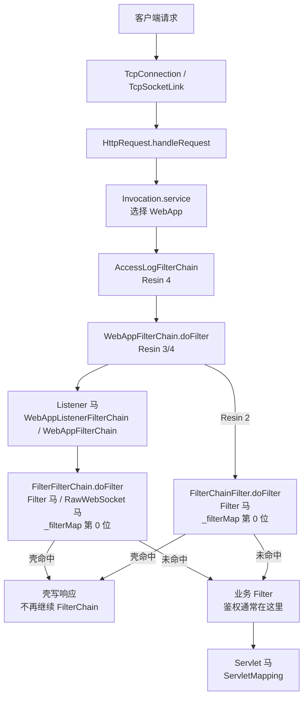

Resin 使用 `com.caucho.` 包名，请求从 TCP 连接进入 `HttpRequest`，再由 `Invocation` 选中 Web 应用，依次执行 Filter、Listener 与 Servlet。Resin 2 使用 `Resin2` 服务类型，只提供 Servlet 与 Filter；Resin 3/4 使用 `Resin` 服务类型，额外支持 Listener、RawWebSocket 与 AgentFilterChain。

## 请求链路

Resin 3 的 Listener 由 `WebAppFilterChain.doFilter` 在进入 `FilterFilterChain` 之前触发；Resin 4 换成 `WebAppListenerFilterChain`，位置不变，仍在业务 Filter 之前。Resin 2 没有 Listener 挂载类型，链路里没有这一环。

## 挂载点与触发时机

| 类型 | 挂载点 | 触发时机 | URL 约束 | Filter 位置 |
| --- | --- | --- | --- | --- |
| Listener | `_requestListeners` / `addListenerObject` | `WebAppFilterChain` 内、Filter 前 | 无 URL，WebApp 内全部请求 | 之前 |
| Filter | `_filterMapper._filterMap[0]` | `FilterFilterChain` 链首 | `/*` 或 path 模式 | 链首位 |
| Servlet | `addServletMapping` / `addDispatchMap` | Filter 链之后 | 精确或前缀映射 | 之后 |
| RawWebSocket | Filter，同 Filter 马 | 握手请求 | 同 Filter | 链首位 |
| AgentFilterChain | `FilterChainFilter.doFilter` / `FilterFilterChain.doFilter` | Filter 链入口 | 无 URL | 之前 |

Resin 2 只有 Servlet 和 Filter；Listener、RawWebSocket、AgentFilterChain 从 Resin 3 开始提供。各版本的完整支持矩阵见 [目标服务](/docs/server-intro#resin)。

## Listener 与 Filter 的 URL 规则

**Listener 没有 URL。** 注入器把壳加进 `_requestListeners` 并清空缓存，请求只要被分到该 WebApp 就会触发。Resin 3/4 的 Listener 在业务 Filter 之前执行，最终 404 的路径同样会触发；已在 Resin 3.1 与 4.0 上验证。Resin 2 不提供 Listener 挂载，需要监听请求时只能用 Filter。

**Filter 的 URL 不需要和已声明 Servlet 对齐。** Resin 的 `FilterMapper` 把 `FilterMapping` 的 URL 模式和请求路径直接比较，`/*`、`/prefix/*`、`*.ext` 和精确路径都有效。注入器把壳插到 `_filterMap` 第 0 位并调用 `clearCache`，因此先于业务 Filter。已在 Resin 2.1、3.1、4.0 上验证 `/*` 的 Filter 马对不存在的 `/app/no-such-path` 可以直接返回 200。

请求不需要先完成 Servlet 映射，Filter 链在 `Invocation.service` 阶段就会建立；即使最终 404，Filter 也已经执行。Filter 只处理 `REQUEST` 派发，FORWARD、INCLUDE、ERROR、ASYNC 不会再次触发壳。

## 其他限制

**RawWebSocket** 是 Resin 3/4 的 Filter。壳完成 101 后由 helper 在连接器层接管 socket：Resin 4 走 `startDuplex`，Resin 3 走 `upgradeProtocol`。它不依赖容器的 WebSocket API，也不要求 Servlet 3.1，不依赖 `Upgrade` 和 `Connection` 逐跳头。Resin 2 没有对应的 helper，需要 WebSocket 时升级到 Resin 3/4。

**AgentFilterChain** 由 Java Agent 改写 `com.caucho.server.http.FilterChainFilter.doFilter`（旧版代码路径）或 `com.caucho.server.dispatch.FilterFilterChain.doFilter` 的字节码，在 Filter 链入口执行，不需要 URL；Resin 2 不提供这一挂载类型。Agent 马的存活依赖 agent 进程，可选持久化，具体见 [Java Agent 内存马](/docs/agent-shell)。
