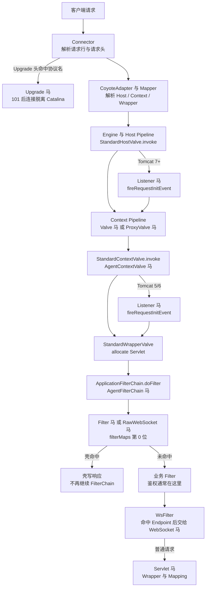
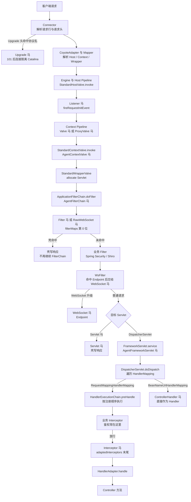

Tomcat 的请求处理分两段：Connector 层的 Coyote 负责解析 HTTP，Mapper 把 URL 解析到 Host、Context、Wrapper；之后进入 Catalina 的四层 Pipeline。Tomcat 内存马做的就是在这条链路的某一环插入代码。

## 请求链路

主链路有两个分叉需要先记住：Upgrade 在 Connector 内完成，根本不进 Catalina；其余请求按 Engine、Host、Context、Wrapper 的 Pipeline 顺序走。Tomcat 7 起 Listener 在 `StandardHostValve` 内触发，排在 Context Pipeline 之前；Tomcat 5/6 的 Listener 由 `StandardContextValve.invoke` 触发，排在 Context Pipeline 之后。`StandardContextValve` 的 404 检查发生在 Wrapper Pipeline 之前，`ApplicationFilterChain` 则由 `StandardWrapperValve` 创建，这个先后决定了下面 Filter 的 URL 约束。

## 挂载点与触发时机

| 类型 | 挂载点 | 触发时机 | URL 约束 | Filter 位置 |
| --- | --- | --- | --- | --- |
| Listener | `applicationEventListeners` | Tomcat 7+：HostValve 内，Pipeline 前；5/6：`StandardContextValve.invoke` 内，Pipeline 后 | 无 URL，Context 内全部请求（5/6 不含 `/WEB-INF/*` 与未命中 Wrapper 的路径） | 之前 |
| Valve | `pipeline.valves` | Basic Valve 前 | 无 URL，404 路径也触发 | 之前 |
| ProxyValve | `pipeline.first` | 所有 Valve 前 | 同上 | 之前 |
| Filter | `filterMaps[0]` | Filter 链首 | `/*` 或 path 模式 | 链首位 |
| Servlet | Wrapper 与 mapping | Filter 后 | 精确或前缀映射 | 之后 |
| AgentContextValve | `StandardContextValve` | `invoke` | 无 URL | 之前 |
| AgentFilterChain | `ApplicationFilterChain` | `doFilter` | 无 URL | 之前 |
| WebSocket | `ServerContainer` | WsFilter 命中后 | Endpoint 路径或模板 | 之后 |
| RawWebSocket | Filter，同 Filter 马 | 握手请求 | 同 Filter | 链首位 |
| Upgrade | `httpUpgradeProtocols` | Catalina 前 | 无 URL，`Upgrade` 头匹配 | 不经 |

Tomcat 10/11 中，Servlet、Filter、Listener、Valve、ProxyValve、WebSocket、RawWebSocket 使用 `Jakarta` 前缀，Upgrade、Agent 类型没有前缀。各版本的完整支持矩阵见 [目标服务](/docs/server-intro#tomcat)。

表中的“Filter 位置”指相对业务 Filter 的执行顺序。鉴权通常写在业务 Filter（Spring Security、Shiro、自研登录 Filter）或 Spring MVC Interceptor 里，只有位置在它之前的挂载点才能绕开。

## Listener 与 Filter 的 URL 规则

这是两种最容易被 URL 约束绊住的类型。

**Listener 没有 URL。** 注入器把它加进 `StandardContext.applicationEventListeners`。Tomcat 7 起，`StandardHostValve` 先调用 `fireRequestInitEvent`，再调用 `context.getPipeline().getFirst().invoke`，Listener 马比 Context Pipeline 里的所有 Valve 马都早，包括挂在 `pipeline.first` 上的 ProxyValve 马，最终 404 的路径和会被 `StandardContextValve` 拦下的 `/WEB-INF/*` 也都会触发。Tomcat 5/6 由 `StandardContextValve.invoke` 触发，Context Pipeline 上的 Valve 马已经执行完，Listener 马排在它们之后；触发点还在 `/WEB-INF/*` 检查和 Wrapper 选择之后，没有选中 Wrapper 的路径不会触发。是否命中由壳自己检查参数或请求头，不需要为它声明任何 Servlet 或 Filter 映射。以上顺序已在 Tomcat 5.5、6.0、7、8、9、10、11 上通过调用栈验证。

**Filter 的 URL 不需要和已声明 Servlet 对齐。** Tomcat 在 `ApplicationFilterFactory.createFilterChain` 中把 FilterMap 的 pattern 直接和 Context 相对请求路径比较，`/*`、`/prefix/*`、`*.ext` 和精确路径都有效，与是否存在对应的 Servlet 声明无关。注入器把 Filter 放在 `filterMaps` 第 0 位，因此它先于业务 Filter 执行。已在 Tomcat 5.5、6.0、7、8、9、10、11 上验证 `/*` 的 Filter 对不存在的 `/app/no-such-path` 可以直接返回 200。

但请求仍然要能落到一个 Wrapper。`StandardContextValve` 在 Wrapper 为空时直接 404，`ApplicationFilterChain` 只在 `StandardWrapperValve` 中创建。Tomcat 通常有一个默认映射兜底（独立部署时是 default servlet，Spring Boot 下是映射到 `/` 的 DispatcherServlet），所以 `/*` 对绝大多数路径成立；如果应用删掉了默认映射，指向不存在路径的请求会在到达 Filter 之前 404，这时壳的 URL 必须落在已有 Servlet 的映射内。

这也是 Tomcat 与部分中间件的差异：有的容器把 Filter 绑定在 ServletWrapper 上，URL 必须和已声明的 Servlet 对齐；Tomcat 不是这种实现，Filter 的 URL 可以独立写，约束只有“请求能完成 Wrapper 解析”。

FilterMap 的 dispatcher 默认只有 `REQUEST`，注入器没有额外声明，所以 FORWARD、INCLUDE、ERROR、ASYNC 派发不会再次触发壳。

## 其他限制

**Upgrade** 挂在 Connector 的 `httpUpgradeProtocols` 上，key 是注入器写入的壳类名。客户端需要发送 `Connection: Upgrade`，且 `Upgrade` 头的值与这个 key 完全一致（大小写敏感），`Http11Processor` 才会在进入 `CoyoteAdapter` 之前完成 101。`Upgrade` 和 `Connection` 是逐跳头，Nginx、CDN 默认不转发，放在反向代理后面的场景优先选 RawWebSocket。Tomcat 5~7 没有这条映射，Upgrade 从 Tomcat 8 开始可用。

**WebSocket** 注册到 ServletContext 中的 `ServerContainer`，路径是 Endpoint 路径而不是 Servlet 映射。Tomcat 的 `WsServerContainer` 初始化时把 `WsFilter` 映射到 `/*`，`WsFilter` 只处理带 WebSocket 升级头且路径能命中已注册 Endpoint 的请求，其余请求继续走 Filter 链。Endpoint 路径只支持精确路径或 URI 模板（如 `/shell/{name}`），不能写 `/*`；注入器为 Godzilla 4.15 追加的 `<url>/{pass}` 就是 URI 模板。Tomcat 5/6 没有 JSR-356，用 RawWebSocket；Tomcat 10/11 用 `JakartaWebSocket`。

**RawWebSocket** 不是 JSR-356 Endpoint，而是一个 Filter。壳识别 `GET` 与 `Sec-WebSocket-Key`，完成 101 后由 helper 反射拿到 Connector 的底层 socket，自己跑帧循环。它不依赖 `Upgrade` 和 `Connection`，能穿过会剥掉逐跳头的 Nginx、CDN，触发路径仍受 Filter 的 URL 规则约束。

**Agent 类型** 不修改容器注册表，而是由 Java Agent 改写 `ApplicationFilterChain.doFilter` 或 `StandardContextValve.invoke` 的字节码。前者在 Filter 链入口执行，后者在 Context Basic Valve 入口执行，都不需要 URL。Agent 马的存活依赖 agent 进程，可选持久化，具体见 [Java Agent 内存马](/docs/agent-shell)。

## SpringWebMVC + Tomcat

SpringWebMVC 跑在 Tomcat 上时，Upgrade、Listener、Valve、Filter、Servlet、WebSocket 等容器级挂载点全部有效，只是 Wrapper 从业务 Servlet 换成了 `DispatcherServlet`；进入 `DispatcherServlet` 后再多出三种框架级挂载点。下面的链路从 Connector 一直画到 Controller 方法。

下表只列 `DispatcherServlet` 内部的三种框架级类型，容器级类型见上一节。

| 类型 | 挂载点 | 触发时机与约束 |
| --- | --- | --- |
| Interceptor | `adaptedInterceptors` 末尾 | `preHandle`；只处理 RequestMappingHandlerMapping 命中的请求，业务 Interceptor 先执行 |
| ControllerHandler | `handlerMap` | HandlerMapping 查找阶段；注册在 BeanNameUrlHandlerMapping，新增 URL 不能被 RequestMappingHandlerMapping 先命中 |
| AgentFrameworkServlet | `FrameworkServlet.service` | 进入 DispatcherServlet 后、`doDispatch` 前；在 Servlet Filter 之后、MVC Interceptor 之前 |

**鉴权在 Filter 时**，Spring Security 的 `FilterChainProxy`、Shiro 的 `ShiroFilter` 都是 Servlet Filter，执行在 `DispatcherServlet` 之前，上面三种框架级内存马都绕不过。能绕开的是排在业务 Filter 之前的挂载点：Listener、Valve、ProxyValve、AgentContextValve、AgentFilterChain、Filter 马和 RawWebSocket，以及 Connector 层的 Upgrade。Filter 马的注入器把壳放在 `filterMaps` 第 0 位，因此它自动先于 `FilterChainProxy` 执行；Servlet 马、WebSocket 马在业务 Filter 之后，绕不过。

**鉴权在 Interceptor 时**，Interceptor 马追加在 `adaptedInterceptors` 末尾，业务 Interceptor 先执行，鉴权拒绝的请求到不了它；ControllerHandler 挂在另一个 HandlerMapping 上，通常不经过 `WebMvcConfigurer` 注册的业务 Interceptor，但 Spring Security 这类 Filter 仍然在前；AgentFrameworkServlet 在 `doDispatch` 之前，也不经过 Interceptor。

Interceptor 没有 URL，壳会收到 RequestMappingHandlerMapping 能处理的所有请求，是否命中靠壳自己判断；ControllerHandler 需要一个新的、未被占用的 URL。Spring Boot 3/4 选择 `JakartaInterceptor`、`JakartaControllerHandler`，Spring Boot 1/2 选择不带前缀的 `Interceptor`、`ControllerHandler`；`AgentFrameworkServlet` 同时支持 javax 与 jakarta，没有 Jakarta 变体。
