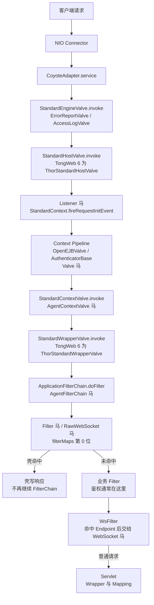

TongWeb 基于 Tomcat 二开，每个大版本都改了包名：TongWeb 6 是 `com.tongweb.web.thor.`，TongWeb 7 是 `com.tongweb.catalina.`，TongWeb 8 是 `com.tongweb.server.`，内嵌 Spring Boot 版本是 `com.tongweb.container.`。请求仍然走 Engine、Host、Context、Wrapper 四层 Pipeline，Listener 在 Host Valve 内触发。TongWeb 6/7 默认是 javax，TongWeb 7 内嵌 Spring Boot 使用 Jakarta。

## 请求链路

TongWeb 6/7/8 的 Listener 都在 Host Valve 内调用 `StandardContext.fireRequestInitEvent`，位置早于 Context Pipeline 和 Filter 链；TongWeb 6 的 Host Valve 类名是 `ThorStandardHostValve`，7/8 是 `StandardHostValve`。

## 挂载点与触发时机

| 类型 | 挂载点 | 触发时机 | URL 约束 | Filter 位置 |
| --- | --- | --- | --- | --- |
| Listener | `applicationEventListeners` | `StandardHostValve.invoke` | 无 URL，Context 内全部请求 | 之前 |
| Valve | `context.getPipeline().addValve` | Basic Valve 前 | 无 URL，404 路径也触发 | 之前 |
| Filter | `filterMaps[0]` | `ApplicationFilterChain` 链首 | `/*` 或 path 模式 | 链首位 |
| WebSocket | `ServerContainer` | WsFilter 命中后 | Endpoint 路径或模板 | 之后 |
| RawWebSocket | Filter，同 Filter 马 | 握手请求 | 同 Filter | 链首位 |
| AgentFilterChain | `ApplicationFilterChain.doFilter` | Filter 链入口 | 无 URL | 之前 |
| AgentContextValve | `StandardContextValve.invoke` | Context Basic Valve 入口 | 无 URL | 之前 |

TongWeb 不提供 Servlet 挂载类型，需要 Servlet 形态时用 Filter 马处理任意路径。各版本的完整支持矩阵见 [目标服务](/docs/server-intro#tongweb)。

## Listener 与 Filter 的 URL 规则

**Listener 没有 URL。** 注入器把壳加进 `applicationEventListeners`（不同版本对应 `applicationEventListenersObjects` 数组或 `applicationEventListenersList` 列表），Host Valve 在进入 Context Pipeline 之前调用 `fireRequestInitEvent`。请求只要被 Mapper 分到该 Context 就会触发，包括最终 404 的路径，并且早于所有 Valve 和 Filter。已在 TongWeb 6、7、8 上抓到同一个调用栈。

**Filter 的 URL 不需要和已声明 Servlet 对齐。** 注入器按版本加载对应的 `FilterDef` / `FilterMap`，通过 `addFilterDef` 注册，把新 FilterMap 放到 `filterMaps` 数组第 0 位，再写入 `filterConfigs`。TongWeb 在 `ApplicationFilterFactory` 中把 pattern 直接和 Context 相对路径比较，`/*`、`/prefix/*`、`*.ext` 和精确路径都有效。已在 TongWeb 6、7、8 上验证 `/*` 的 Filter 马对不存在的 `/app/no-such-path` 可以直接返回 200。

请求仍然要能落到一个 Wrapper。`StandardContextValve` 在 Wrapper 为空时直接 404，`ApplicationFilterChain` 只在 `StandardWrapperValve` 中创建；TongWeb 默认有映射到 `/` 的 default servlet，所以 `/*` 对绝大多数路径成立。FilterMap 的 dispatcher 默认只有 `REQUEST`，FORWARD、INCLUDE、ERROR、ASYNC 派发不会再次触发壳。

## 其他限制

**Valve** 追加到 Context Pipeline，排在 `StandardContextValve` 之前。Listener 在 HostValve 阶段已经执行，所以 Listener 马比 Valve 马更早，Valve 马绕不过 Listener 马。Valve 没有 URL，404 路径也会触发。

**WebSocket** 通过 TongWeb 自带的 JSR-356 `ServerContainer` 注册 Endpoint。TongWeb 7.0.8+ 热部署应用不会自动初始化 WebSocket 容器，注入器会在运行时补齐 `ServerContainer` 与 `WsFilter`。TongWeb 7 内嵌 Spring Boot 使用 `jakarta.websocket`，其余版本使用 `javax.websocket`。Endpoint 路径只支持精确路径或 URI 模板，不能写 `/*`。

**RawWebSocket** 是一个 Filter，helper 复用 Tomcat 的连接器实现，并按 `com.tongweb.web.thor` / `com.tongweb.catalina` / `com.tongweb.server` / `com.tongweb.container` 四个包名分支适配。它不依赖 `Upgrade` 和 `Connection` 逐跳头，能穿过会剥掉这些头的 Nginx、CDN。

**Agent 类型** 由 Java Agent 改写对应包名的 `ApplicationFilterChain.doFilter` 或 `StandardContextValve.invoke` 字节码，分别在 Filter 链入口和 Context Basic Valve 入口执行，不需要 URL。Agent 马的存活依赖 agent 进程，可选持久化，具体见 [Java Agent 内存马](/docs/agent-shell)。
