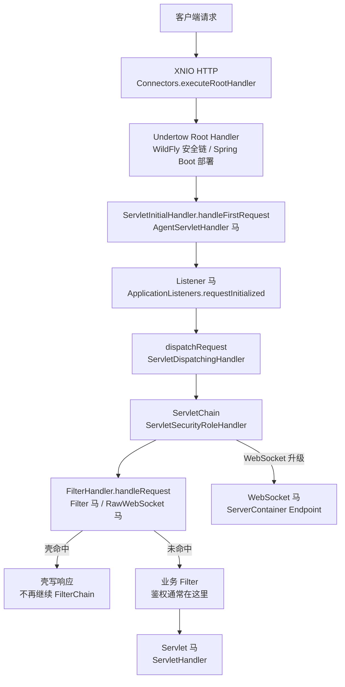
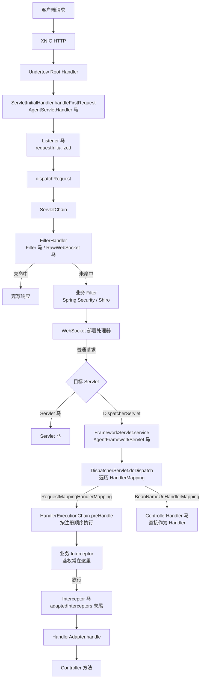

Undertow 是 JBoss 社区开发的 Servlet 容器，WildFly 9~41、JBoss EAP 7/8 以及 Spring Boot 的 `spring-boot-starter-undertow` 都使用它。请求先经过 Undertow 的 XNIO Handler 链，再进入 Servlet 部署的 `ServletInitialHandler`、Filter 链和 Servlet。服务类型选择 Undertow 时，javax 与 Jakarta 部署共用同一套挂载点。

## 请求链路

`ServletInitialHandler.dispatchRequest` 对每个 `REQUEST` 派发都会调用 `firstRequestHandler`，Listener 因此在每次请求上触发，而不是只在部署后的第一个请求上触发。它位于 Filter 链之前，也早于 Servlet 映射。

## 挂载点与触发时机

| 类型 | 挂载点 | 触发时机 | URL 约束 | Filter 位置 |
| --- | --- | --- | --- | --- |
| Listener | `deployment.applicationListeners` | `ServletInitialHandler.handleFirstRequest` | 无 URL，部署内全部请求 | 之前 |
| Filter | `DeploymentInfo.filterUrlMappings[0]` | `FilterHandler` 链首 | `/*`、前缀、扩展名或精确路径 | 链首位 |
| Servlet | `ServletInfo.addMapping` 与 `servletPaths` | Filter 链之后 | 精确、前缀或扩展名映射 | 之后 |
| WebSocket | `ServerContainer.addEndpoint` | WebSocket 升级请求 | Endpoint 路径或 URI 模板，不能 `/*` | 视 WebSocket 部署处理器 |
| AgentServletHandler | `ServletInitialHandler.handleFirstRequest` | Servlet 请求入口 | 无 URL | 之前 |
| RawWebSocket | Filter，同 Filter 马 | `GET` 与 `Sec-WebSocket-Key` | 同 Filter | 链首位 |

Undertow 1.x~2.2.x 与 WildFly 9~26、EAP 7 使用 javax 类型；Undertow 2.3.x+ 与 WildFly 27+、EAP 8 使用 `Jakarta` 前缀的类型。各版本的完整支持矩阵见 [目标服务](/docs/server-intro#undertow)。

## Listener 与 Filter 的 URL 规则

**Listener 没有 URL。** 注入器把壳包装成 `ManagedListener` 加进 `deployment.applicationListeners`，`ApplicationListeners.requestInitialized` 在 `ServletInitialHandler.handleFirstRequest` 中调用，早于 `dispatchRequest` 和 Filter 链。请求只要进入该 Servlet 部署就会触发，包括最终 404 的路径。已验证 WildFly 9、26、41 与 EAP 7、8.1 的监听器都在这个位置触发。

**Filter 的 URL 不需要和已声明 Servlet 对齐。** Undertow 在 `ServletPathMatches` 中把 `FilterMappingInfo` 的 URL 模式直接和请求路径比较，支持 `/*`、`/prefix/*`、`*.ext` 和精确路径，另外兼容非标准的 `*`（等价于 `/*`）。注入器用 `insertFilterUrlMapping(0, ...)` 把壳插到映射列表首位，并让过滤器失效后重建，因此先于业务 Filter。已验证在 WildFly 9、26、41 与 EAP 7、8.1 上，`/*` 的 Filter 马对不存在的 `/app/no-such-path` 也能直接返回 200。

请求仍然要能落到一个 Servlet 链。Undertow 的默认 Servlet（映射 `/`）负责兜底，`FilterHandler` 在 `ServletChain` 中执行；如果部署里没有默认 Servlet，未匹配路径会在 Filter 之前结束。Filter 的 dispatcher 只声明 `DispatcherType.REQUEST`，FORWARD、INCLUDE、ERROR、ASYNC 派发不会再次触发壳。

## 其他限制

**WebSocket** 通过 Undertow 自带的 JSR-356 `ServerContainer` 注册 Endpoint。注入器会先复位部署的完成标记，再调用 `addEndpoint` 并刷新 Filter 匹配器，使运行中的部署能够接受新 Endpoint。独立 Undertow（如 Spring Boot）需要 classpath 中存在 `undertow-websockets-jsr`（`spring-boot-starter-undertow` 默认包含）；WildFly/EAP 自带。Undertow 2.3.x+ 使用 `JakartaWebSocket`。Endpoint 路径只支持精确路径或 URI 模板，不能写 `/*`。

**RawWebSocket** 是一个 Filter。壳从当前请求/响应取出 `HttpServerExchange`，调用 `upgradeChannel` 让 Undertow 在刷出 101 响应后交出 `org.xnio.StreamConnection`，再由 helper 跑帧循环；同时把 exchange 标记为持久连接，避免 Nginx 把 `Connection` 改成 `close` 后连接被回收。WildFly/EAP 的 webapp 类加载器看不到 `io.undertow.server`，helper 里的代理必须用接口自己的类加载器定义。Undertow 1.x~2.3.x 的 javax / Jakarta 部署共用同一份实现。

**AgentServletHandler** 由 Java Agent 改写 `io.undertow.servlet.handlers.ServletInitialHandler.handleFirstRequest` 的字节码，在部署处理入口执行，早于 Listener 和 Filter，不需要 URL。Agent 马的存活依赖 agent 进程，可选持久化，具体见 [Java Agent 内存马](/docs/agent-shell)。

## SpringWebMVC + Undertow

Spring Boot 1.x/2.x 使用 Undertow 1.x/2.2（javax），Spring Boot 3.x 使用 Undertow 2.3+（Jakarta）。容器级挂载点全部有效，Wrapper 是 `DispatcherServlet`，进入后再多出三种框架级挂载点。

| 类型 | 挂载点 | 触发时机与约束 |
| --- | --- | --- |
| Interceptor | `adaptedInterceptors` 末尾 | `preHandle`；只处理 RequestMappingHandlerMapping 命中的请求，业务 Interceptor 先执行 |
| ControllerHandler | `handlerMap` | HandlerMapping 查找阶段；注册在 BeanNameUrlHandlerMapping，新增 URL 不能被 RequestMappingHandlerMapping 先命中 |
| AgentFrameworkServlet | `FrameworkServlet.service` | 进入 DispatcherServlet 后、`doDispatch` 前；在 Servlet Filter 之后、MVC Interceptor 之前 |

**鉴权在 Filter 时**，Spring Security 的 `FilterChainProxy`、Shiro 的 `ShiroFilter` 都是 Servlet Filter，执行在 `DispatcherServlet` 之前，三种框架级内存马都绕不过。能绕开的是排在业务 Filter 之前的挂载点：AgentServletHandler、Listener、Filter 马和 RawWebSocket。AgentServletHandler 在 `handleFirstRequest` 入口，Listener 在 `requestInitialized`，Filter 马被放到 `filterUrlMappings` 首位。Servlet 马、WebSocket 马在业务 Filter 之后，绕不过。

**鉴权在 Interceptor 时**，Interceptor 马追加在 `adaptedInterceptors` 末尾，业务 Interceptor 先执行；ControllerHandler 挂在另一个 HandlerMapping 上，通常不经过 `WebMvcConfigurer` 注册的业务 Interceptor，但 Spring Security 这类 Filter 仍然在前；AgentFrameworkServlet 在 `doDispatch` 之前，也不经过 Interceptor。

Spring Boot 3/4 选择 `JakartaInterceptor`、`JakartaControllerHandler`，Spring Boot 1/2 选择不带前缀的 `Interceptor`、`ControllerHandler`；`AgentFrameworkServlet` 同时支持 javax 与 jakarta，没有 Jakarta 变体。
