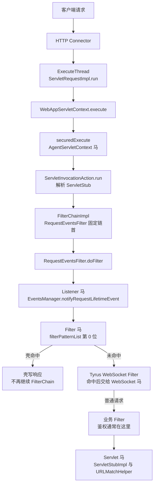

WebLogic 的请求从 Connector 交给 `ExecuteThread`，由 `WebAppServletContext.execute` 找到目标 Servlet，再经 `securedExecute` 进入应用。与 Tomcat 不同，WebLogic 没有对外的 Valve 扩展点，Listener 也不是在 Context 执行阶段触发，而是由容器内置的 `RequestEventsFilter` 在 Filter 链首派发。WebLogic 10.3.6/12.x/14.x 使用 javax 类型，15.x 使用 Jakarta 类型。

## 请求链路

`FilterManager.getFilterChain` 先把 `reqEventsFilterWrapper` 加到链首，再遍历 `filterPatternList` 追加应用 Filter。Listener 由 `RequestEventsFilter` 在 `chain.doFilter` 之前调用，因此 Listener 马排在所有应用 Filter（包括注入的壳）之前；这是 WebLogic 与 Catalina 系容器最大的差别。

## 挂载点与触发时机

| 类型 | 挂载点 | 触发时机 | URL 约束 | Filter 位置 |
| --- | --- | --- | --- | --- |
| Listener | `eventsManager.requestListeners` | `RequestEventsFilter.doFilter` | 无 URL，已解析 Servlet 的请求 | 链首 Filter 内 |
| Filter | `filterPatternList[0]` | Filter 链 | `/*` 或 path 模式 | 链首应用 Filter |
| Servlet | `ServletStubImpl` 与 `URLMatchHelper` | Filter 链之后 | 精确、前缀或扩展名映射 | 之后 |
| WebSocket | Tyrus `ServerContainer` | WebSocket 升级请求 | Endpoint 路径或模板 | Tyrus Filter |
| RawWebSocket | Filter，同 Filter 马 | 握手请求 | 同 Filter | 链首应用 Filter |
| AgentServletContext | `WebAppServletContext.securedExecute` | 解析 Servlet 之前 | 无 URL | 之前 |

WebLogic 10.3.6 没有可用的 JSR-356 WebSocket，WebSocket 类型不可用；12.2.1+ 才有 Tyrus。各版本的完整支持矩阵见 [目标服务](/docs/server-intro#weblogic)。

## Listener 与 Filter 的 URL 规则

**Listener 没有 URL，但它依赖 Filter 链。** 注入器把壳注册到 `EventsManager.requestListeners`，`RequestEventsFilter` 在链首调用 `notifyRequestLifetimeEvent`，请求只要解析到了 Servlet（包括默认 Servlet）就会触发。已在 WebLogic 10.3.6、12.2.1 与 15.1.1 上验证 `/app/no-such-path` 会触发；如果应用没有默认 Servlet、路径完全无法解析到 `ServletStub`，`getFilterChain` 不会被调用，Listener 也不会触发。

**Filter 的 URL 不需要和已声明 Servlet 对齐。** `FilterManager` 遍历 `filterPatternList`，用 `URLMapping` 把 pattern 和请求的相对 URI 比较，`/*`、`/prefix/*`、`*.ext` 和精确路径都有效。注入器把壳插到 `filterPatternList` 第 0 位，并清空 `chainCache`，因此先于业务 Filter。已在 WebLogic 10.3.6、12.2.1、15.1.1 上验证 `/*` 的 Filter 马对不存在的 `/app/no-such-path` 可以直接返回 200。

注入器注册的 dispatcher 是 `REQUEST`、`FORWARD`、`INCLUDE`、`ERROR`，这是 WebLogic 与其他容器的又一个差异：通过 `RequestDispatcher.forward`、include 或错误页转发到壳的路径时，壳仍会再次执行。`isApplicable` 会按当前派发类型过滤，ASYNC 不在其中。

## 其他限制

**WebSocket** 在 WebLogic 12.2.1+ 通过 Tyrus 的 JSR-356 `ServerContainer` 注册。部署结束后 `addEndpoint` 会拒绝新增，注入器改用 Tyrus 的 `register` 直接写入引擎，`register` 不存在时才回退到 `addEndpoint`。WebLogic 12/14 会把 Tyrus 的 Filter 追加在业务 Filter 之后，业务 Filter 若不支持 async，Tyrus 握手时的 `startAsync` 会失败；注入器会把 WebSocket 的映射移到普通应用映射之前。WebLogic 10.3.6 没有 JSR-356，只能选 RawWebSocket。

**RawWebSocket** 是一个 Filter。壳完成 101 后由 helper 从 `ServletRequestImpl` 取到 `Socket`，再用 native controls pipe 自己跑帧循环。WebLogic NIO 会把响应头暂存在 `GatheringChunkOutput` 中，helper 必须反射调用 `realChunkOutput` 把缓冲刷出去，否则客户端收不到 101。WebLogic 10.3.6、12.2.1.4、14.1.2、15.1.1 都已实际连接验证。

**AgentServletContext** 由 Java Agent 改写 `weblogic.servlet.internal.WebAppServletContext.securedExecute` 的字节码，在 Servlet 解析和 Filter 链之前执行，不需要 URL。Agent 马的存活依赖 agent 进程，可选持久化，具体见 [Java Agent 内存马](/docs/agent-shell)。
