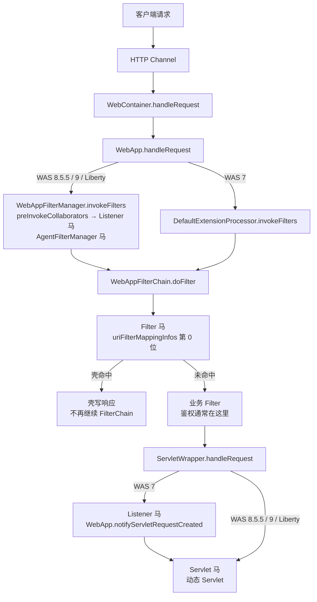

WebSphere 使用 `com.ibm.ws.webcontainer` 作为 Servlet 容器，请求从 HTTP Channel 进入 `WebContainer`，由 `WebApp` 组装 Filter 链并调用 Servlet。WAS 7 与 8.5.5/9 在 Listener 的触发位置上有本质差别：WAS 7 在 Filter 链结束、进入 Servlet 之后才触发，8.5.5/9 与 Open Liberty 在 Filter 链入口触发。WebSphere 只有 javax 类型，没有 Jakarta 变体。

## 请求链路

WAS 7 的 Listener 由 `ServletWrapper.handleRequest` 调用 `WebApp.notifyServletRequestCreated` 触发，此时 Filter 链已经执行完，而且请求必须命中一个 Servlet。8.5.5/9 与 Liberty 在 `CollaboratorHelper.preInvokeCollaborators` 中触发，位置在 Filter 链入口，早于所有应用 Filter。

## 挂载点与触发时机

| 类型 | 挂载点 | 触发时机 | URL 约束 | Filter 位置 |
| --- | --- | --- | --- | --- |
| Listener | `servletRequestListeners` | WAS 7：`ServletWrapper.handleRequest`；8.5.5/9/Liberty：`invokeFilters` 入口 | 无 URL | WAS 7 之后，8.5.5+ 之前 |
| Filter | `uriFilterMappingInfos[0]` | Filter 链首 | `/*` 或 path 模式 | 链首位 |
| Servlet | `addDynamicServlet` | Filter 链之后 | 按 Servlet 映射规则 | 之后 |
| WebSocket | `com.ibm.ws.wsoc` ServerContainer | WebSocket 升级请求 | Endpoint 路径或模板 | — |
| RawWebSocket | Filter，同 Filter 马 | 握手请求 | 同 Filter | 链首位 |
| AgentFilterManager | `WebAppFilterManager.doFilter` | Filter 链入口 | 无 URL | 之前 |

WAS 7 没有 JSR-356；WAS 8.5.5 默认安装不含 WebSocket 功能，安装后才有 `com.ibm.ws.wsoc`；WAS 9 与 Open Liberty 自带。各版本的完整支持矩阵见 [目标服务](/docs/server-intro#websphere)。

## Listener 与 Filter 的 URL 规则

**Listener 没有 URL，但两个版本的时机不同。** WAS 7 的 `ServletWrapper.handleRequest` 在 Filter 链继续到 Servlet 之后才调用 `notifyServletRequestCreated`：如果前面的 Filter 直接写响应、不调用 `chain.doFilter`，Listener 不会触发；请求没有命中 Servlet 时也不会触发。WAS 8.5.5/9 与 Liberty 在 `WebAppFilterManager.invokeFilters` 的入口调用 `preInvokeCollaborators`，Listener 在 Filter 之前触发，即使业务 Filter 随后短路也已经被调用。注入器把壳包装成 `ManagedObjectListenerWrapper` 后追加到 `servletRequestListeners`，不改变这个时机。

**Filter 的 URL 不需要和已声明 Servlet 对齐。** 注入器用 `FilterMapping(urlPattern, filterConfig, null)` 注册，`dispatchMode` 默认是 `REQUEST`；匹配只比较请求 URI，`/*`、`/prefix/*`、`*.ext` 和精确路径都有效。壳被插到 `uriFilterMappingInfos` 第 0 位（WAS 7 是 `_uriFilterMappings`），并清空 `chainCache`，因此先于业务 Filter。已在 WAS 7 与 WAS 9 上验证 `/*` 的 Filter 马对不存在的 `/app/no-such-path` 可以直接返回 200；WAS 8.5.5 使用同一套 `WebAppFilterManager`。

WAS 7 的 Filter 链由 `DefaultExtensionProcessor` 在 Servlet 解析前建立，未匹配路径也会执行 Filter；8.5.5/9 在 `WebApp.handleRequest` 中建立 Filter 链。只有 `REQUEST` 派发会触发壳，FORWARD、INCLUDE、ERROR、ASYNC 不会再次触发。

## 其他限制

**WebSocket** 通过 `com.ibm.ws.wsoc` 的 `ServerContainerExt` 注册 Endpoint。第一个 WebSocket 请求到达后，`ServerContainerExt` 会关闭 `addEndpoint`；注入器先把 `noMoreAdds` 复位为 `false`，再调用 `addEndpoint`，因此运行中的应用也能新增 Endpoint。WAS 8.5.5 需要额外安装 WebSocket 1.0 功能，未安装时没有 `ServerContainer`；WAS 7 没有该实现，只能选 RawWebSocket。

**RawWebSocket** 是一个 Filter，所有 WebSphere 版本都可使用，不依赖 `HttpUpgradeHandler`。helper 直接通过连接器的异步 IO 上下文接管 socket；AIO 读取按 1 字节轮询，否则小于读缓冲的帧会丢数据。接管前要先把 HTTP 解析器里已经缓冲的字节搬走。收尾时只关闭 `socketIOChannel`，不要调用会归还连接池的 `destroy`，否则连接回到池中后，下一个请求可能收到旧连接残留的 200 响应。

**AgentFilterManager** 由 Java Agent 改写 `com.ibm.ws.webcontainer.filter.WebAppFilterManager.doFilter` 的字节码，在 Filter 链入口执行，不需要 URL。WAS 7 需要开启 debug 模式才允许 attach。Agent 马的存活依赖 agent 进程，可选持久化，具体见 [Java Agent 内存马](/docs/agent-shell)。
