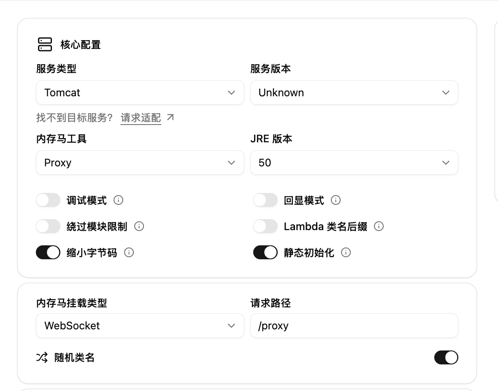

import { Step, Steps } from "fumadocs-ui/components/steps";

参考地址：https://github.com/veo/wsMemShell/blob/main/static/websocketproxy.md

## WebSocket 内存马

<Steps>
<Step>
### 选择 Proxy



</Step>

<Step>
### 生成并注入

选取合适的打包方式，并进行内存马的注入。

</Step>
<Step>
### 使用 Gost 客户端尝试启动代理

https://github.com/go-gost/gost

```bash
❯ ./gost -L :1080 -F "ws://127.0.0.1:8082?path=/app/proxy"
{"handler":"auto","kind":"service","level":"info","listener":"tcp","msg":"listening on [::]:1080/tcp","service":"service-0","time":"2026-01-16T23:15:55.143+08:00"}
```

尝试使用 curl 命令使用代理访问百度

```bash
> curl -x socks5h://127.0.0.1:1080 https://www.baidu.com
```

</Step>
</Steps>

WebSocket/JakartaWebSocket 通过容器的 JSR-356 实现注册 Endpoint，需要直连容器使用。Nginx 或 CDN 会剥离
`Upgrade` 头，这种场景请选择 RawWebSocket/JakartaRawWebSocket。
